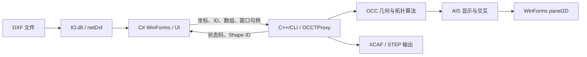
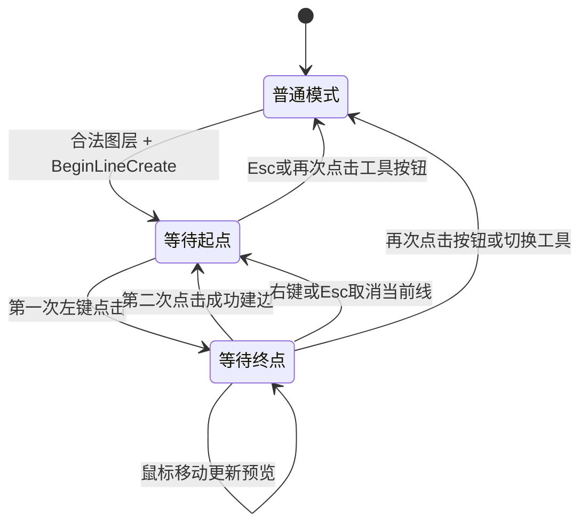

# SuperTire-Preprocess 软件汇报方案

**主题：OCC 集成与部署，以及两点直线绘制的完整实现。**

建议采用 **45 分钟标准版，包含 4 分钟演示和 4 分钟讨论**。本方案基于当前工作区源码、工程配置、本机 OCC 头文件和 DLL 版本信息整理；没有重新编译、启动软件或完成交互验收。下文的“已实现”指源码中存在实现，现场效果应在会前试跑确认。源码行号以 2026-09-11 检查时为准。

## 一、汇报主线与时间分配

全程围绕一个问题展开：**用户在屏幕上点击两次，软件怎样得到一条有几何含义、能按图层管理、能继续参与建模和导出的线？**

| 页码 | 内容 | 30 分钟版 | 45 分钟版 | 60 分钟版 |
|---|---|---:|---:|---:|
| 1 | 软件目标与本次汇报范围 | 1 | 2 | 3 |
| 2 | 三层架构与数据流 | 2 | 3 | 4 |
| 3 | OCC 集成、封装与继承关系 | 2 | 3 | 4 |
| 4 | 工程配置和部署现状 | 3 | 4 | 6 |
| 5 | OCC 视口嵌入 WinForms | 2 | 3 | 4 |
| 6 | 几何、拓扑、显示和业务 ID | 2 | 3 | 4 |
| 7 | DXF 导入直线与手工直线的区别 | 1 | 2 | 3 |
| 8 | 进入绘制模式与交互状态机 | 2 | 3 | 4 |
| 9 | 屏幕坐标到绘图平面 | 3 | 4 | 5 |
| 10 | 自动吸附的算法和容差 | 2 | 3 | 4 |
| 11 | 动态预览、正式建边与图层登记 | 2 | 3 | 4 |
| 12 | 取消、退出与错误处理 | 1 | 2 | 3 |
| 13 | 软件现场演示 | 3 | 4 | 5 |
| 14 | 当前边界与下一阶段工作 | 1 | 2 | 2 |
| 15 | 导师讨论与问题答复 | 3 | 4 | 5 |
| **合计** | **单位：分钟** | **30** | **45** | **60** |

30 分钟版只展示下文的核心代码，不展开 Haft、公式示例和异常分支。60 分钟版增加源码走读、吸附对比和部署检查说明，保持同一条主线。

准备材料以 15 页为宜，每页放一个核心结论、一个图或一段短代码。整段函数在 IDE 中看，投影页代码尽量控制在 8–15 行。

## 二、逐页讲解与讲稿

### 第 1 页：软件要解决什么问题

**页面内容**：轮胎截面 DXF → 几何编辑与补线 → 图层／组件管理 → STEP 几何输出。

**可以直接讲：**

“这个软件面向轮胎截面几何的前处理。当前代码包含 DXF 导入、线条编辑、补画直线、制面、帘线创建、拓扑编辑和 STEP 导出等入口。今天重点介绍两部分：一是 OCC 内核怎样接入现有 C# 软件，二是以手工绘制一条直线为例，说明界面事件怎样进入几何内核，并最终形成可管理的模型对象。”

“这里的工作成果主要是把图纸、交互操作和几何处理串成一套流程。OCC 提供基础几何与拓扑算法，我们负责组织调用、管理状态、维护图层数据并反馈操作结果。”

**讲述边界**：程序输出名虽然是 `dwg-to-stp.exe`，实际导入入口筛选的是 `.dxf`，读取调用是 `DxfDocument.Load`。不能据程序名声称已经直接支持 DWG；也不能把 STEP 几何输出称为已完成有限元网格划分。

**代码**：[导入入口](<D:/GuoYanLin-Code/SuperTire-Preprocess - 2026.8.11/FrmMain.cs:53>)、[IO 读取](<D:/GuoYanLin-Code/SuperTire-Preprocess - 2026.8.11/IO/DataInteraction.cs:12>)、[导出入口](<D:/GuoYanLin-Code/SuperTire-Preprocess - 2026.8.11/FrmMain.cs:246>)。

**过渡**：“为了把这些操作接到 OCC，程序分成三个工程。”

### 第 2 页：三层架构与数据流



| 部分 | 当前代码职责 | 主要文件 |
|---|---|---|
| UI | 窗体、模型树、当前图层、鼠标事件、日志、业务流程 | `FrmMain.cs`、`FrmMain.InterfaceInteraction.cs`、`FrmMain.TreeView.cs` |
| IO | 使用 netDxf 读取文件，返回文档和错误信息 | `IO/DataInteraction.cs` |
| OCCT | 托管代理、原生几何算法、AIS 对象、显示和导出 | `OCCTProxy.h`、`Proxy/*.cpp`、`Internal/*.inl` |

**可以直接讲：**

“界面层知道用户想做什么，代理层把业务参数交给 OCC，OCC 生成或修改几何对象，再把结果状态和 ID 交还给界面。C# 端主要管理图层和操作状态，C++ 端持有真正的 OCC 对象，两边通过整数 ID 对应。”

“IO 层当前负责读取 DXF 文档，图层分配、实体遍历以及调用 OCC 建边仍然发生在 FrmMain 中。这是目前的实际分工，后面还可以进一步拆分业务服务。”

**代码**：[工程引用](<D:/GuoYanLin-Code/SuperTire-Preprocess - 2026.8.11/UI.csproj:123>)、[代理接口](<D:/GuoYanLin-Code/SuperTire-Preprocess - 2026.8.11/OCCT/OCCTProxy.h:9>)、[全局对象表](<D:/GuoYanLin-Code/SuperTire-Preprocess - 2026.8.11/OCCT/OCCTState.cpp:3>)。

### 第 3 页：区分集成、封装和继承

**页面核心结论**：项目通过 C++/CLI 封装并调用 OCC；`OCCTProxy` 持有 OCC 对象，未显式继承 OCC 的原生类。

实际代码：

```cpp
public ref class OCCTProxy
{
public:
    bool InitViewer(System::IntPtr theWnd);
    bool BeginLineCreate(double tolerance);
private:
    NCollection_Haft<Handle(V3d_Viewer)> myViewer;
    NCollection_Haft<Handle(V3d_View)> myView;
    NCollection_Haft<Handle(AIS_InteractiveContext)> myAISContext;
    NCollection_Haft<Handle(OpenGl_GraphicDriver)> myGraphicDriver;
};
```

以上摘取自同一类的不同位置，省略了其他成员。

**可以直接讲：**

“这里的集成，是把 OCC 能力接到软件；封装，是通过 OCCTProxy 向 C# 提供接口；继承，则是类之间的父子关系。这三件事需要区分。我的代理类使用组合方式持有 Viewer、View 和交互上下文，界面通过它调用 OCC。”

“`public ref class` 是托管类，C# 可以创建它并调用兼容的公共接口。`array<int>^` 在 C# 侧接收为 `int[]`，`IntPtr` 用于传递窗口句柄。OCC 自身对象使用 `Handle(...)` 管理引用，`NCollection_Haft` 则把原生 C++ 对象包在托管成员中；代码里的 `myView()` 是访问内部 Handle 的运算符调用。”

**真正涉及的继承链**，已核对本机 OCC 7.7.0 头文件：

```text
FrmMain → System.Windows.Forms.Form

AIS_Shape → AIS_InteractiveObject → SelectMgr_SelectableObject
          → PrsMgr_PresentableObject → Standard_Transient

TopoDS_Edge → TopoDS_Shape
```

箭头表示“继承自”。`AIS_Shape` 持有 `TopoDS_Shape`，两者之间是包装／持有关系，不是父子类关系。几何、拓扑、显示三者也不是一条继承链。

**代码**：[FrmMain 的继承](<D:/GuoYanLin-Code/SuperTire-Preprocess - 2026.8.11/FrmMain.cs:18>)、[OCCTProxy](<D:/GuoYanLin-Code/SuperTire-Preprocess - 2026.8.11/OCCT/OCCTProxy.h:9>)、[Haft 的原生成员包装](<D:/OpenCASCADE-7.7.0-vc14-64/opencascade-7.7.0/inc/NCollection_Haft.h:28>)、[AIS_Shape](<D:/OpenCASCADE-7.7.0-vc14-64/opencascade-7.7.0/inc/AIS_Shape.hxx:60>)、[TopoDS_Edge](<D:/OpenCASCADE-7.7.0-vc14-64/opencascade-7.7.0/inc/TopoDS_Edge.hxx:34>)。

### 第 4 页：工程配置与部署

**页面核心结论**：部署需要对齐托管程序集、原生内核 DLL、位数、版本和资源路径。

| 配置项 | 当前查到的事实 | 汇报口径 |
|---|---|---|
| UI / IO | .NET Framework 4.7.2 | 现有程序基于 .NET Framework |
| C++/CLI | `CLRSupport=true`，`PlatformToolset=v142` | 代理工程启用 CLR，使用 v142 工具集 |
| 目标平台 | OCCT 的 x64 配置为 DynamicLibrary | 以解决方案 x64 配置作为现有构建路线 |
| include/lib | 指向 `D:\OpenCASCADE-7.7.0-vc14-64\opencascade-7.7.0` | 工程当前配置接入 OCC 7.7.0 |
| 仓库 SDK 目录 | 存在 `opencascade-7.9.3-vc14-64` | 目录存在不能证明工程已经切换版本 |
| Debug 输出中的内核 | TKernel、TKV3d、TKOpenGl 文件版本均为 7.7.0 | 磁盘上的这三个关键运行库与 7.7.0 配置相符 |
| UI Debug 输出 | `bin\x64\Debug\` | 演示程序与依赖应在对应输出环境检查 |
| 代理 Debug 输出 | `dwg-to-stp\MAIN\` | 代理构建产物与 UI 输出目录不同，需要确认复制结果 |

**可以直接讲：**

“编译、链接和运行解决的是三类问题。编译时需要头文件声明，链接时需要库文件解析符号，运行时需要真正的 DLL 和资源。因此，只把 OCCT.dll 放到另一台机器，并不足以代表部署完成。”

“当前工程链接了 TKernel、TKMath、TKBRep、TKTopAlgo、TKV3d、TKService 以及 STEP/XCAF 等模块。TKOpenGl 等依赖还通过 OCCT.cpp 中的 `#pragma comment(lib, ...)` 声明，检查依赖时要同时看工程和源码。”

“当前可以确定配置和已检查的 DLL 都指向 7.7.0。我尚未用目标机器的运行验证证明整个发布包已经可移植，所以部署阶段仍需做依赖整理和独立环境验证。”

**开发构建步骤，作为操作建议而非本次已执行结果：**

1. 准备支持现有 v142、C++/CLI、Windows SDK 和 .NET Framework 4.7.2 目标的构建环境。
2. 打开 `SuperTire-Preprocess.sln`，选用 x64，确认 UI、IO、OCCT 的配置映射。
3. 检查 OCCT 头文件、`.lib` 与拟部署 DLL 版本一致；不要只改 SDK 目录名。
4. 构建后检查 UI 输出里的 `OCCT.dll`、`IO.dll`、`netDxf.dll` 与主程序是否配套。
5. 目标机器验证原生运行库、OCC DLL 和资源路径，再验证导入、绘制、导出。

**部署目录示意，表示待整理结构，不代表已有自动打包：**

```text
发布目录/
  dwg-to-stp.exe + 对应配置文件
  OCCT.dll / IO.dll / netDxf.dll
  与该构建匹配的 OCC 原生 DLL 和第三方 DLL
  对应版本的 OCC 资源目录
  启动配置或部署脚本
```

本机 OCC 7.7.0 的 `env.bat` 中可以看到 PATH、`CSF_ShadersDirectory`、`CSF_XCAFDefaults`、`CSF_STEPDefaults` 等资源设置；这能说明资源配置方式，不能证明 UI 启动时自动执行了该脚本。完整原生依赖和运行库清单应通过构建产物依赖检查确认。

**特别留意**：OCCT 的 Win32 配置仍是 Application，Any CPU 配置映射也与 x64 不同；不要仅凭解决方案里有这些选项，就声称所有平台都已支持。现有 Debug 代理启用调试库，但 OCC 库路径指向 `lib`，目标机部署必须结合实际依赖核查；今晚不宜临时切换一套没有演练的发布配置。

**代码**：[UI 配置](<D:/GuoYanLin-Code/SuperTire-Preprocess - 2026.8.11/UI.csproj:11>)、[代理 x64 配置](<D:/GuoYanLin-Code/SuperTire-Preprocess - 2026.8.11/OCCT/OCCT.vcxproj:44>)、[绝对路径和输出路径](<D:/GuoYanLin-Code/SuperTire-Preprocess - 2026.8.11/OCCT/OCCT.vcxproj:76>)、[额外链接声明](<D:/GuoYanLin-Code/SuperTire-Preprocess - 2026.8.11/OCCT/OCCT.cpp:4>)、[本机环境脚本](<D:/OpenCASCADE-7.7.0-vc14-64/opencascade-7.7.0/env.bat:254>)。

### 第 5 页：OCC 怎样嵌入 WinForms

实际启动链：

```text
Program.Main
→ Application.Run(new FrmMain())
→ 构造 OCCTProxy、绑定 panel2D 事件
→ 窗体 Load / Form1_Load
→ InitViewer(panel2D.Handle)
→ OpenGl_GraphicDriver → V3d_Viewer → V3d_View
→ WNT_Window(HWND) → View.SetWindow
→ AIS_InteractiveContext → 显示与交互
```

关键代码摘录：

```cpp
myViewer() = new V3d_Viewer(myGraphicDriver());
myView() = myViewer()->CreateView();
Handle(WNT_Window) aWNTWindow = new WNT_Window(
    reinterpret_cast<HWND>(theWnd.ToPointer()));
myView()->SetWindow(aWNTWindow);
myAISContext() = new AIS_InteractiveContext(myViewer());
```

| 对象 | 汇报时怎样解释 |
|---|---|
| OpenGl_GraphicDriver | 对接图形渲染驱动 |
| V3d_Viewer | 管理查看器及默认灯光等共享设置 |
| V3d_View | 管理当前视图、相机、投影、缩放和重绘 |
| WNT_Window | 把 Windows 窗口句柄接给 OCC |
| AIS_InteractiveContext | 管理交互对象的显示、隐藏、检测和选择 |

**可以直接讲：**

“WinForms 的 panel2D 提供窗口位置和句柄，OCC 把渲染视图绑定到这个窗口里。因此 panel2D 虽然叫二维面板，里面运行的仍是 OCC 三维查看器；二维绘图约束由我们后面的绘图平面逻辑实现。”

“窗口变化时，Resize 事件先调用 MustBeResized，再 Redraw，使视口尺寸与宿主窗口一致。”

**不要讲错**：`InitView()` 中确实调用了 `InitOCCTProxy()`，但目前检查到的启动调用链没有调用 `InitView()`。应把 `Form1_Load → InitViewer` 作为实际入口。初始化也没有看到强制 `SetProj` 到顶视图的调用，不能声称进入绘图时一定自动回到顶视图。

**代码**：[程序入口](<D:/GuoYanLin-Code/SuperTire-Preprocess - 2026.8.11/Program.cs:16>)、[窗体构造](<D:/GuoYanLin-Code/SuperTire-Preprocess - 2026.8.11/FrmMain.cs:23>)、[Load 绑定](<D:/GuoYanLin-Code/SuperTire-Preprocess - 2026.8.11/FrmMain.Designer.cs:313>)、[视口初始化](<D:/GuoYanLin-Code/SuperTire-Preprocess - 2026.8.11/OCCT/Proxy/OCCTProxy.Viewer.cpp:5>)、[Resize](<D:/GuoYanLin-Code/SuperTire-Preprocess - 2026.8.11/FrmMain.cs:346>)。

### 第 6 页：一条线的四种表达

```text
几何数据：gp_Pnt / 曲线数据 —— 点在哪里、曲线是什么
拓扑对象：TopoDS_Edge       —— 具有有限范围的边
显示对象：AIS_Shape         —— 怎么显示、如何参与交互
业务对象：Shape ID + 图层   —— 属于谁、如何查找和管理
```

**可以直接讲：**

“用户看到的线与内核里的边不是同一层数据。两点首先构成几何输入，MakeEdge 建立有限长度的拓扑边，AIS_Shape 负责把这条边显示出来，最后用 ID 接到图层管理。”

“C# 中的 `Dictionary<TreeNode, List<int>> layerShapesMap` 保存图层到 ID 集合的映射；C++ 中的 `GlobalShapeMap` 保存 ID 到 AIS 对象的映射。界面不必直接持有原生 TopoDS 对象，也能根据图层批量显示或隐藏。”

**关系示例，ID 仅为说明：**

```text
图层“基体” → [101, 102]
GlobalShapeMap[101] → AIS_Shape → TopoDS_Edge
GlobalShapeMap[102] → AIS_Shape → TopoDS_Edge
```

`Deactivate` 关闭选择，`Erase` 隐藏显示，`Remove` 从上下文移除对象；对象是否仍登记在业务表里，还需要看对应的 map 操作。不要把这三种操作都称为“删除几何”。

**代码**：[C# 图层映射](<D:/GuoYanLin-Code/SuperTire-Preprocess - 2026.8.11/FrmMain.TreeView.cs:11>)、[C++ 对象映射](<D:/GuoYanLin-Code/SuperTire-Preprocess - 2026.8.11/OCCT/OCCTState.cpp:3>)、[显隐操作](<D:/GuoYanLin-Code/SuperTire-Preprocess - 2026.8.11/OCCT/Proxy/OCCTProxy.Visibility.cpp:8>)。

### 第 7 页：两条直线创建路径

| 项目 | DXF 中导入的直线 | 用户手工画的直线 |
|---|---|---|
| 输入 | DXF 中已有的起终点 | 鼠标坐标，经投影和吸附得到两点 |
| UI 调用 | `LoadDxfToOCC → CreateLine` | `HandleLineCreateClick → AddLineCreatePoint` |
| 过程 | 批量遍历实体 | 绘制会话、两次落点、动态预览 |
| 结果 | 生成 Edge、AIS，写入 ID 表 | 生成 Edge、红色 AIS，成功后回传 ID |
| 归属 | 原始 DXF 图层 | 完成时的当前绘图图层 |

导入直线的核心代码：

```cpp
gp_Pnt aPnt1(X1, Y1, Z1);
gp_Pnt aPnt2(X2, Y2, Z2);
TopoDS_Shape aShape = BRepBuilderAPI_MakeEdge(aPnt1, aPnt2);
Handle(AIS_Shape) aisShape = new AIS_Shape(aShape);
GlobalShapeMap[id] = aisShape;
myAISContext()->Display(aisShape, Standard_False);
```

**可以直接讲：**“导入与手绘最终都建立 OCC 边，但手绘多出了解决人机交互的一整套过程。下面以手绘路径作为主要例子。”

参数顺序要注意：`CreateLine(id, X1, X2, Y1, Y2, Z1, Z2)`，不是按两个 XYZ 三元组排列。当前 C# 调用与该顺序匹配。

多段线和样条走另一条离散点路径；不在此页展开，也不能把当前采样重建称为保留原始解析曲线的完全精确导入。

**代码**：[DXF 直线遍历](<D:/GuoYanLin-Code/SuperTire-Preprocess - 2026.8.11/FrmMain.cs:112>)、[CreateLine](<D:/GuoYanLin-Code/SuperTire-Preprocess - 2026.8.11/OCCT/Proxy/OCCTProxy.BasicGeometry.cpp:9>)。

### 第 8 页：绘制前置条件与状态机

**入口流程**：普通图层右键 Make Current → 点击“直线绘制” → `EnterLineCreateMode` → `BeginLineCreate` → 切换 UI 模式。

前置检查：当前节点必须是 `layerShapesMap` 中的普通“图层:”或“图层：”节点；Viewer 和 AIS Context 必须有效。当前绘图图层与用于制面的 Current Component 是两套状态。



**可以直接讲：**

“画线是一段会话，不是每次点击都直接建边。UI 的 `InteractionMode.LineCreate` 决定鼠标事件走哪条业务分支；C++ 的 Active 和 HasFirstPoint 决定当前是在等待起点，还是等待终点。”

“画线时左键不再启动旋转，鼠标移动优先更新预览，中键仍可以平移。真正落点在 MouseUp，要求 X、Y 两个方向的按下与抬起位移都小于 3 像素，避免把拖动识别成一次点击。”

`BeginLineCreate` 清理上次会话，设置 XOY 平面和容差，停用普通几何选择。完成一条线后回到“等待起点”，不会自动把上一条的终点延续为下一条起点。

**代码**：[当前图层](<D:/GuoYanLin-Code/SuperTire-Preprocess - 2026.8.11/FrmMain.TreeView.cs:365>)、[按钮入口](<D:/GuoYanLin-Code/SuperTire-Preprocess - 2026.8.11/FrmMain.cs:565>)、[开启会话](<D:/GuoYanLin-Code/SuperTire-Preprocess - 2026.8.11/OCCT/Proxy/OCCTProxy.BasicGeometry.cpp:126>)、[交互模式](<D:/GuoYanLin-Code/SuperTire-Preprocess - 2026.8.11/FrmMain.InterfaceInteraction.cs:17>)、[MouseUp](<D:/GuoYanLin-Code/SuperTire-Preprocess - 2026.8.11/FrmMain.InterfaceInteraction.cs:209>)。

### 第 9 页：屏幕坐标如何成为模型坐标

**核心代码摘录**：

```cpp
myView()->ConvertWithProj(theX, theY, x, y, z, vx, vy, vz);
const gp_Vec projectionDirection(vx, vy, vz);
const gp_Lin viewRay(gp_Pnt(x, y, z), gp_Dir(projectionDirection));
IntAna_IntConicQuad intersection(
    viewRay, GlobalLineCreatePlane,
    Precision::Angular(), GlobalLineCreateTolerance);
const gp_Pnt cursorPoint = intersection.Point(1);
```

以上省略了方向退化和求交成功检查，实际代码先验证结果，再取交点。

**可以直接讲：**

“鼠标只有屏幕上的两个坐标，但 OCC 模型空间有三个坐标。一个屏幕点在空间中对应一条视线，仅凭鼠标位置不能唯一决定深度。我们先通过 ConvertWithProj 得到视线上的一点和投影方向，再与固定的 XOY 平面求交，才得到唯一的自由绘图点。”

**解释公式，代码实际调用 OCC 求交器：**

设视线为 `P(t) = O + tD`，绘图平面经过 Q、法向为 N，则：

```text
t = N·(Q − O) / N·D
P = O + tD
XOY 平面：Q=(0,0,0)，N=(0,0,1)
所以在 Dz 不为 0 时，t = −Oz / Dz
```

**60 分钟版可用的纯数学例子**：O=(10,20,100)，D=(0,0,-1)，交点就是 (10,20,0)。这只是解释原理，不是从软件运行中采集的数据。

“如果视线与平面平行，或没有得到有效交点，就拒绝这次落点。点击时会重新计算投影和吸附，避免采用上一帧鼠标移动保存的旧坐标。”

**边界必须讲准确**：自由投影点在 Z=0；之后吸附代码可能直接采用已有几何上的三维点，当前没有看到吸附候选的共面过滤。因此严格二维性依赖输入几何共面的条件，不能声称任意三维图纸下吸附后仍绝对保持 Z=0。

**代码**：[设定平面](<D:/GuoYanLin-Code/SuperTire-Preprocess - 2026.8.11/OCCT/Proxy/OCCTProxy.BasicGeometry.cpp:141>)、[投影求交](<D:/GuoYanLin-Code/SuperTire-Preprocess - 2026.8.11/OCCT/Proxy/OCCTProxy.BasicGeometry.cpp:160>)、[点击时重新求点](<D:/GuoYanLin-Code/SuperTire-Preprocess - 2026.8.11/OCCT/Proxy/OCCTProxy.BasicGeometry.cpp:287>)。

### 第 10 页：自动吸附怎样实现

**页面内容**：可见对象 → 先找顶点 → 有顶点立即返回 → 否则找边上的最近点 → 无候选保留自由点。

```cpp
const Standard_Real snapDistance = std::max(
    std::abs(myView()->Convert(12)),
    GlobalLineCreateTolerance * 5.0);
```

**可以直接讲：**

“吸附分成两遍。第一遍遍历可见 AIS_Shape 中的顶点，找吸附范围内最近的顶点；只要找到顶点就直接返回。第二遍仅在没有顶点候选时进行，提取各个 Shape 的边，用 BRepExtrema_DistShapeShape 求鼠标点到有限边的最短距离和边上对应点。”

“这里不是在顶点和边之间简单选全局最近位置，而是明确采用顶点优先，方便用户补线时准确落到已有边界端点。”

**60 分钟版解释例子**：假设某次吸附半径为 1 个模型单位，附近端点距离 0.8，边上的最近点距离 0.1，仍然选择端点。这个数字是算法示例，不是实测指标。

| 概念 | 实际作用 |
|---|---|
| `geometryTolerance=0.01` | 当前 UI 约定模型单位为 mm，用于两点过近等判断 |
| `Convert(12)` | 把约 12 个屏幕像素换算成视图尺度下的模型距离 |
| `tolerance×5` | 吸附半径下限；默认对应 0.05 个模型单位 |
| `IsDisplayed` | 隐藏对象不参与候选 |
| `TopExp::MapShapes` | 从 Shape 提取顶点或边，支持复合 Shape 中的子形状 |

像素范围是交互尺度，不等于建模精度。斜视时模型距离与屏幕距离的对应也不能描述成严格的二维 12 像素圆。

**边界**：当前未见独立的中点、交点、正交、切线或网格吸附策略；也未建立空间索引。每次预览遍历可见对象并可能逐边算最短距离，规模增大时需要评估性能，不能在没有测试时声称达到某个帧率。

**代码**：[吸附半径](<D:/GuoYanLin-Code/SuperTire-Preprocess - 2026.8.11/OCCT/Proxy/OCCTProxy.BasicGeometry.cpp:211>)、[两遍吸附搜索](<D:/GuoYanLin-Code/SuperTire-Preprocess - 2026.8.11/OCCT/Internal/OCCT.LineCreateHelpers.inl:72>)。

### 第 11 页：预览怎样转成正式几何

| 视觉状态 | 代码中的表达 | 是否登记 GlobalShapeMap |
|---|---|---|
| 自由光标 | 浅灰十字 AIS_Point | 否 |
| 已吸附光标 | 黄色圆十字 AIS_Point | 否 |
| 已确定起点 | 青色圆十字 AIS_Point | 否 |
| 动态预览线 | 橙黄色 AIS_Shape，线宽 2.0 | 否 |
| 已完成直线 | 红色 AIS_Shape，采用统一显示设置 | 是 |

**可以直接讲：**

“鼠标移动时先移除上一帧的光标和预览线，再建立新一帧的临时显示对象。起点已经确定时予以保留。预览也会构建临时 Edge，但它没有进入业务对象表；正式完成之后才分配业务身份。”

第二点点击后的关键步骤，以下为同一函数的简化摘录：

```cpp
BRepBuilderAPI_MakeEdge edgeBuilder(
    GlobalLineCreateFirstPoint, pickedPoint);
if (!edgeBuilder.IsDone())
    return MakeLineCreateResult(-3, -1);
Handle(AIS_Shape) line = MakeHighQualityAISShape(edgeBuilder.Edge());
line->SetColor(Quantity_Color(1.0, 0.0, 0.0, Quantity_TOC_RGB));
RemoveLineCreatePreview(myAISContext(), Standard_True);
GlobalShapeMap[newShapeId] = line;
myAISContext()->Display(line, Standard_False);
myAISContext()->Deactivate(line);
```

随后复位起点状态、刷新显示，返回 `[2, newShapeId]`。C# 收到成功后：

```csharp
layerShapesMap[currentLineLayerNode].Add(result[1]);
globalShapeId = Math.Max(globalShapeId, result[1] + 1);
```

“新线在绘制期间不能被普通选择，却仍然显示并登记在对象表中，因此能够立即成为后续直线的吸附候选。显示、选择和业务登记是不同的状态。”

**归属细节**：代码在第二点成功后读取 `currentLineLayerNode`。因此如果在两次点击之间切换当前图层，正在完成的这条线也会进入新的图层，并非起点点击时锁定归属。

**与后续流程的连接**：手工线有业务 ID 和图层归属，能进入现有显隐和导出遍历；制面等算法可以接收对应的线 ID。但这不等于补线时已自动打断旧边、生成共享拓扑顶点或自动重建面。

**代码**：[预览显示](<D:/GuoYanLin-Code/SuperTire-Preprocess - 2026.8.11/OCCT/Proxy/OCCTProxy.BasicGeometry.cpp:225>)、[正式建边](<D:/GuoYanLin-Code/SuperTire-Preprocess - 2026.8.11/OCCT/Proxy/OCCTProxy.BasicGeometry.cpp:343>)、[UI 登记](<D:/GuoYanLin-Code/SuperTire-Preprocess - 2026.8.11/FrmMain.cs:613>)、[统一显示包装](<D:/GuoYanLin-Code/SuperTire-Preprocess - 2026.8.11/OCCT/Proxy/OCCTProxy.Viewer.cpp:258>)。

### 第 12 页：取消、退出与错误处理

| 操作 | 实际行为 |
|---|---|
| 指定起点后按右键 | 清除当前临时线，保留绘图模式 |
| 指定起点后按 Esc | 先取消当前线，继续等待起点 |
| 没有起点时按 Esc | 退出绘图模式 |
| 再次点直线工具或切换其他工具 | 清理未完成预览，退出直线会话 |
| 退出后 | 已完成直线保留，恢复普通形状选择 |

| `result[0]` | 含义 | UI 处理重点 |
|---:|---|---|
| 1 | 起点确定 | 提示选终点 |
| 2 | 正式直线完成 | 登记图层、推进 ID |
| 0 | 当前点无法投影 | 提示调整视角 |
| -1 | 没有开启会话 | 当前 UI 进入默认失败提示 |
| -2 | 两点距离不大于容差 | 保留起点，重选终点 |
| -3 | 建边失败或正式创建段抛出 OCC 异常 | 当前 UI 进入默认失败提示 |
| -4 | ID 无效或冲突 | 提示冲突 |

**可以直接讲：**

“取消当前线与退出整个工具是两个操作。我们明确区分临时对象和正式对象，所以取消只处理当前预览，不会把前面已经完成的直线清掉。返回值同时带状态和 ID，让 C# 在成功之后再登记业务数据。”

**讲述限制**：当前异常捕获只包围正式建边后的一段流程，投影和吸附发生在它之前，不能声称所有 OCC 异常都被捕获。ID 冲突分支只报告错误，没有自动寻找新 ID。`-3` 提示“重新指定两个点”，而底层失败路径未必重置起点，后续应统一提示与状态。

**代码**：[Esc](<D:/GuoYanLin-Code/SuperTire-Preprocess - 2026.8.11/FrmMain.InterfaceInteraction.cs:527>)、[取消当前线](<D:/GuoYanLin-Code/SuperTire-Preprocess - 2026.8.11/OCCT/Proxy/OCCTProxy.BasicGeometry.cpp:385>)、[结束会话](<D:/GuoYanLin-Code/SuperTire-Preprocess - 2026.8.11/OCCT/Proxy/OCCTProxy.BasicGeometry.cpp:407>)、[返回数组](<D:/GuoYanLin-Code/SuperTire-Preprocess - 2026.8.11/OCCT/Internal/OCCT.LineCreateHelpers.inl:4>)。

### 第 13 页：4 分钟现场演示脚本

**会前准备**：使用事先验证过、几何位于 Z=0 的小型 DXF，至少包含两个普通图层和几条间距足够的线；要演示制面扩展时，另备含“基体”图层的闭合轮廓。不要拿唯一一份工作结果直接演示。这里的“准备”是待执行清单，本次没有生成或加载示例 DXF。

| 时间 | 操作 | 同时讲什么 | 看什么证明成功 |
|---|---|---|---|
| 0:00–0:35 | 导入小图纸，缩放到清楚可见，确认接近顶视 | DXF 解析和 OCC 显示连接起来 | 图形与图层树同时出现 |
| 0:35–0:55 | 在普通图层右键 Make Current，点直线工具 | 先确定几何归属，再开启会话 | 图层 Current 标记、绘制提示 |
| 0:55–1:35 | 在空白处点击起点，移动，点击终点 | 自由点 → 起点 → 预览 → 正式线 | 青色起点、橙色预览、红色结果及成功日志 |
| 1:35–2:10 | 画第二条线，靠近已有端点后点击 | 顶点优先吸附 | 黄色吸附标记，准确落到端点 |
| 2:10–2:35 | 在远离端点的边中部附近移动并落点 | 没有顶点候选时求边上的最近点 | 贴到边上；不宣称旧边已打断 |
| 2:35–3:00 | 指定起点后右键；再指定起点后按两次 Esc | 取消当前线与退出工具不同 | 预览消失、已完成线保留、恢复普通模式 |
| 3:00–3:25 | 隐藏并恢复目标图层 | 新线已进入业务图层映射 | 红色新线随所属图层显隐 |
| 3:25–4:00 | 导出到一个新的 STEP 文件名 | 业务对象进一步进入几何输出流程 | 导出成功日志；文件存在不等于下游验证完成 |

**备用处理**：如果没有合适的图纸或程序行为与预期不符，转到第 8–11 页的代码链讲解，不在会议中临时更改依赖环境。若要证明下游 STEP 可用，必须事先在接收软件中实际打开检查；当前不能用“导出成功”替代这一步。

当前“新建”入口主要清空视口和树，不会自动创建可用的普通绘图图层，所以演示从已验证的 DXF 导入开始。开始导入、清空或切换样例前先退出绘图模式，减少未完成会话干扰。

### 第 14 页：当前边界与下一阶段

**可以直接讲：**

“目前代码已经实现两点绘制、鼠标投影、顶点和边吸附、动态预览、图层登记及取消退出的基本链路。下一步重点是提高二维约束的严格性、会话状态的一致性以及部署的可重复性，然后再扩展更复杂的 CAD 交互。”

| 优先方向 | 源码中的依据 | 下一步具体工作 |
|---|---|---|
| 部署可重复 | SDK 绝对路径、仓库版本与构建配置不同 | 统一版本变量、依赖复制和资源启动配置，在另一环境验收 |
| 严格平面绘图 | 吸附直接使用已有三维点 | 候选共面检查，明确非共面输入处理策略 |
| 状态一致性 | UI 模式和 C++ 全局状态分离；ClearAll 未统一结束直线会话 | 将导入、新建、切换工具纳入统一会话清理，修正提示和失败状态 |
| 交互性能 | 每帧扫描可见 Shape，并重建临时对象 | 缓存顶点／边、按视区筛选或空间索引、减少临时对象创建 |
| 可验证性 | 缺少本次运行验收结果 | 建立小图纸验证：自由画线、吸附、过近点、取消、显隐、导出 |

关于拓扑连接，后续可以研究补线后是否自动打断已有边、构建共享顶点和更新面；这属于后续建模策略，不是当前落点吸附已经完成的行为。

不要把本页讲成泛泛“继续优化”。结束时请导师确认优先级，例如：“下一阶段我计划先把部署和状态一致性做好，再扩展补线后的拓扑处理，想请老师指导这个安排是否符合后续轮胎建模需求。”

### 第 15 页：导师可能追问的 12 个问题

**1. 你到底用了 OCC 哪个版本？**

工程 include/lib 指向 7.7.0，本机对应头文件写明 7.7.0，Debug 输出中检查到的 TKernel、TKV3d、TKOpenGl 也为 7.7.0。仓库另有 7.9.3 目录。当前可确认的是上述配置和文件信息；本次没有采集运行进程的实际加载模块。

**2. 为什么要加 C++/CLI？**

现有 UI 是 C#，OCC 对象和算法是原生 C++。C++/CLI 可以提供 C# 可调用的托管入口，同时在实现中直接使用原生 OCC 类型。它使界面开发和几何处理有明确边界。

**3. OCCTProxy 继承了 OCC 什么类？**

它没有显式继承某个 OCC 原生类，而是持有 Viewer、View、AIS Context 等成员。真正的继承例子是 AIS_Shape 的显示交互层次，以及 TopoDS_Edge 继承 TopoDS_Shape。

**4. 既然是二维软件，为什么使用三维查看器？**

当前几何和拓扑统一由 OCC 处理，视口也是 OCC 的 V3d_View。手工直线的自由落点通过与 XOY 平面求交得到，二维限制由业务算法实现；它与相机是否允许旋转是两件事。

**5. 为什么不直接使用屏幕 X、Y？**

屏幕单位是像素，受缩放、平移和相机投影影响。要得到模型位置，需要先求视线，再与绘图平面求交。

**6. 吸附是不是永远选择最近点？**

不是。顶点有优先级；只要吸附半径内有顶点，就选其中最近的顶点。没有顶点时，才选择有限边上的最近点。

**7. 0.01 和 12 像素各表示什么？**

0.01 是当前 UI 的模型容差设置，代码注释采用 mm；12 像素用于换算吸附交互半径，且半径不小于五倍容差。代码没有在此导入路径中展示完整单位换算，外部 DXF 的单位需要统一。

**8. 吸附到旧边上，旧边就自动分成两段了吗？**

没有。当前代码取得旧边上的坐标，用该点新建一条边，没有在这条绘制路径中调用旧边打断或共享顶点重构。空间坐标相同与拓扑相连需要区分。

**9. 一条直线完成后是否自动继续画折线？**

没有自动沿用终点。完成后 HasFirstPoint 复位，下一条需要重新指定起点；可以借助端点吸附连接到上一条。

**10. 正式线与预览线有什么区别？**

都可能使用 Edge 和 AIS 显示，但预览没有业务 ID 登记，移动或取消时被清理；正式线进入 GlobalShapeMap，C# 成功后把 ID 加入当前图层，退出绘图仍保留。

**11. 这些线能不能导出？**

UI 会把普通 DXF 图层、帘线图层和 Component 的 ID 分组交给导出接口；底层筛选可见 AIS_Shape，以 XCAF 组织装配和 Part，再由 STEPCAFControl_Writer 输出。当前设置保留名称，关闭颜色和图层模式；不能声称颜色及 CAD 图层属性完整保留。实际下游兼容性仍需导入验证。

**12. 你的工作量主要体现在哪里？**

可以从当前实现说明贡献范围：跨语言接口、窗口集成、状态机、屏幕到模型坐标转换、吸附规则、预览生命周期、ID／图层一致性以及导出流程组织。不要把 OCC 自带的建边、距离计算算法说成自己从零发明；个人具体贡献以你实际完成的内容为准，源码注释不足以单独证明作者归属。

## 三、IDE 走读顺序：只固定打开这些位置

| 顺序 | 打开的文件／入口 | 现场只关注什么 |
|---|---|---|
| 1 | [UI.csproj](<D:/GuoYanLin-Code/SuperTire-Preprocess - 2026.8.11/UI.csproj:11>) | Framework、x64、项目引用 |
| 2 | [OCCT.vcxproj](<D:/GuoYanLin-Code/SuperTire-Preprocess - 2026.8.11/OCCT/OCCT.vcxproj:44>) | CLR、工具集、include/lib、输出 |
| 3 | [OCCTProxy.h](<D:/GuoYanLin-Code/SuperTire-Preprocess - 2026.8.11/OCCT/OCCTProxy.h:9>) | 托管接口和原生成员包装 |
| 4 | [InitViewer](<D:/GuoYanLin-Code/SuperTire-Preprocess - 2026.8.11/OCCT/Proxy/OCCTProxy.Viewer.cpp:5>) | panel 句柄接到 OCC |
| 5 | [EnterLineCreateMode](<D:/GuoYanLin-Code/SuperTire-Preprocess - 2026.8.11/FrmMain.cs:577>) | 当前图层检查与开启会话 |
| 6 | [MouseMove / MouseUp](<D:/GuoYanLin-Code/SuperTire-Preprocess - 2026.8.11/FrmMain.InterfaceInteraction.cs:174>) | 预览与落点事件分流 |
| 7 | [UpdateLineCreatePreview](<D:/GuoYanLin-Code/SuperTire-Preprocess - 2026.8.11/OCCT/Proxy/OCCTProxy.BasicGeometry.cpp:160>) | 坐标投影、调用吸附、临时显示 |
| 8 | [FindLineCreateSnapPoint](<D:/GuoYanLin-Code/SuperTire-Preprocess - 2026.8.11/OCCT/Internal/OCCT.LineCreateHelpers.inl:72>) | 顶点优先、边最短距离 |
| 9 | [AddLineCreatePoint](<D:/GuoYanLin-Code/SuperTire-Preprocess - 2026.8.11/OCCT/Proxy/OCCTProxy.BasicGeometry.cpp:277>) | 起点／终点分支、建边与返回 |
| 10 | [HandleLineCreateClick](<D:/GuoYanLin-Code/SuperTire-Preprocess - 2026.8.11/FrmMain.cs:613>) | 成功后登记图层与 ID |

**容易找错的文件**：`OCCT/Proxy/OCCTProxy.LineCreate.cpp` 目前只有 include，没有直线绘制实现，且未列入当前 vcxproj 的 ClCompile。真正实现位于 `OCCTProxy.BasicGeometry.cpp`；内部吸附和清理辅助函数位于 `OCCT.LineCreateHelpers.inl`。不要在会上按文件名打开空实现。

完整调用链速记：

```text
SetCurrentLineLayer
  ↓
tsbLineCreate_Click → EnterLineCreateMode → BeginLineCreate
  ↓
MouseMove → UpdateLineCreatePreview
              → ConvertWithProj → 视线与平面求交
              → FindLineCreateSnapPoint → 临时 AIS 显示
  ↓
MouseUp → HandleLineCreateClick → AddLineCreatePoint
              → 重新投影吸附
              → 第一点击：记录起点，返回 1
              → 第二点击：距离／ID 检查 → MakeEdge
              → AIS_Shape → GlobalShapeMap → 返回 [2, ID]
  ↓
layerShapesMap[currentLineLayerNode].Add(ID)
  ↓
后续图层显隐／几何编辑／STEP 导出
```

## 四、会前 20 分钟准备清单

1. **5 分钟**：在你平时运行的构建环境打开程序，确认直线工具和当前图层菜单存在；确认主程序和 OCCT.dll 配套。本方案没有代替这一步运行验证。
2. **6 分钟**：用一份小型平面 DXF 依次走自由画线、端点吸附、边吸附、右键、两次 Esc、图层显隐。
3. **3 分钟**：导出新文件，若有下游软件则提前打开；记录真正成功的结果，不报告未经测试的兼容性。
4. **3 分钟**：IDE 按上表打开标签页，放大字体，折叠无关代码；确认打开的是 BasicGeometry.cpp。
5. **3 分钟**：练习第 1 页开场和第 14 页收尾，把总时间控制在 45 分钟。

**建议收尾原话：**

“这次汇报主要说明，当前代码已经把界面操作、OCC 几何构造和业务管理连接起来。一条直线的实现覆盖了窗口集成、坐标转换、吸附、状态机、显示和数据登记。下一步我准备优先统一部署环境、补齐状态一致性和共面约束的验证，再根据轮胎截面建模需要扩展补线后的拓扑处理。”
